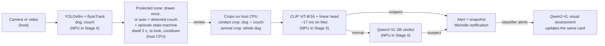

# MischiefCam

> On-device AI that tells you when your dog chews your furniture, and stays quiet when it doesn't.
> Notifications come from **Michelle**, the app's friendly mascot.

Built for the **ASUS UGen AI League** (Battlefield Lightning, ASUS UGen300 / Hailo-10H).
Stage I (this repo) runs on a Mac; Stage II ports the same pipeline to the UGen300
([plan](docs/STAGE2_PORT.md)). *Product name is provisional; see [`config/branding.toml`](config/branding.toml).*

**Demo video:** [TBD: YouTube link] · **Evaluation protocol:** [eval/README.md](eval/README.md) ·
**Models:** [docs/MODELS.md](docs/MODELS.md)

## Why

Pet cameras already send "dog activity" or generic behaviour alerts, and smart cameras can
describe scenes in the cloud for a monthly fee. What owners actually want to know is narrower:
*is the dog damaging the thing I care about, right now?* MischiefCam watches a zone the owner
protects (Stage I: the sofa), decides whether the dog is **chewing it** rather than resting,
sniffing or chewing its own toy, and only then notifies, with a snapshot and a short visual
assessment. Inference runs entirely on the local device (no cloud inference, no subscription);
only the notification itself goes out.

## Results

All numbers come from **AI-generated video** (see [Data](#data)). Development numbers are
optimistic because every setting was chosen on those clips; the held-out test set is the honest one.

| | Caught | False alerts |
|---|---|---|
| **Held-out test set**, 55 clips (frozen model, labelled blind, run once) | **14 / 21 (67%)** | **3 / 34 (9%)** |
| Zone-only baseline on the same set (alert whenever a dog stays in the zone) | 21 / 21 | 32 / 34 (94%) |
| Development set, 111 clips, auto sofa zone (mean of 20 scene-grouped CV splits × 3 VLM runs) | 29.6 / 39 (76%) | 4.7 / 72 (7%) |
| Contrast pairs, scored blind before training (sofa vs look-alike, same scene) | 8 / 10 | 1 / 10 |

Latency on the Stage I prototype: MacBook Pro (Mac16,8), Apple M4 Pro, 24 GB; `mcam-demo`
real-time playback of the 20 contrast-pair clips at 10 FPS, warm-up excluded
([raw report](eval/results/latency_mac_realtime_either.json)):

| Stage | Samples | P50 | P95 |
|---|---|---|---|
| Detector (YOLOv8m + ByteTrack, per frame) | 1180 | 28 ms | 57 ms |
| Classifier (CLIP ViT-B/16 + linear head, per review) | 47 | 20 ms | 22 ms |
| VLM verdict (Qwen2-VL-2B, 4-bit MLX) | 38 | 421 ms | 435 ms |
| VLM visual assessment (after a classifier alert) | 8 | 626 ms | 683 ms |
| Chewing starts → first alert (labelled start vs alert, media time, `batch_run`) | 9 | 2.7 s | 5.2 s |

The alert delay includes the deliberate 2-second dwell before the first review. Running the same
clips with the VLM as the only judge made the detector *slower* (P50 43 ms, P95 77 ms;
[report](eval/results/latency_mac_realtime_vlm_only.json)): the VLM shares the GPU with YOLO, so
letting the cheap classifier decide first also keeps detection smooth. (Two sequential runs, not
interleaved; treat the difference as indicative.)

Hailo-10H figures are vendor numbers until measured on the device: see [STAGE2_PORT.md](docs/STAGE2_PORT.md).

## How it works



- **Two judges, cheap one first.** A linear classifier on frozen CLIP embeddings decides most
  alerts in milliseconds; the VLM is asked only when the classifier says "normal", and catches
  some extra cases. Either one saying "suspect" raises the alert.
- **Contact crop.** The classifier sees a zoom on where the dog's box meets the couch box, so the
  mouth and the cushion fill the 224 px input instead of a few patches (development, 91 clips:
  17.4 → 21.6 positives caught while false alerts fell from 4.5 to 3.0).
- **Honest uncertainty.** "Can't tell" is never turned into "normal" or "yes": the card says
  *Limited view of the mouth — check the snapshot* unless the VLM reports visible evidence.
- **Built to port.** Detector, embedder, VLM and frame source are protocols
  (`src/core/detector.py`, `probe.py`, `vlm.py`, `sources.py`); Stage II adds Hailo backends.

## Data

- **Synthetic clips** generated with [TBD: tool name] from the prompts in `prompts/` (close,
  medium and wide CCTV-style views, hard negatives, contrast pairs). Every demo clip is marked
  "synthetic clip — pre-recorded video, live inference".
- **Labels** are human, time-segmented, mostly blind (`data/labels_*.json`); the rule is in
  [eval/README.md](eval/README.md).
- **Held-out test set** prompts deliberately use breeds, sofas, rooms, camera placements and
  wording that never appear in the training prompts, to test generalisation beyond one generator style.
- **Limitations:** no real-world footage yet; one generator; 8-second clips. False alerts per hour on
  real daily footage are part of the Stage II validation plan.
- **Auto zone risk:** evaluation and demo clips protect every couch the detector finds. In one clip
  (w09) it also boxed a corner with a dog bed as a second "sofa", so a dog resting in its bed is
  judged as if it were on the sofa (the judge still has to say "chewing" to alert). A home camera
  should use a zone confirmed by the owner (draw once with `mcam-roi`; Stage II: auto-detect, then
  confirm or adjust).

## Status

| Item | Status |
|---|---|
| Video / camera source, YOLOv8m + ByteTrack, protected zones (drawn, or auto = detected couch), episode state machine | implemented, unit-tested |
| CLIP classifier (contact crop) + Qwen2-VL-2B, "either" judge | implemented, evaluated on 111 development clips |
| Alert card with asynchronous VLM visual assessment, demo view | implemented, tested in the demo |
| Latency instrumentation (raw per-stage timings, P50 / P95) | implemented |
| Held-out test set (55 clips), zone-only baseline | run once on 2026-10-26 ([details](eval/README.md#held-out-test-results-2026-10-26)) |
| Hailo-10H backends on UGen300 | planned (Stage II, [plan](docs/STAGE2_PORT.md)) |

## License

MischiefCam's own code is licensed under the [Apache License 2.0](LICENSE).
Third-party models and packages keep their own licenses ([docs/MODELS.md](docs/MODELS.md)). The detector,
Ultralytics YOLOv8 (code and weights), is AGPL-3.0: distributing or serving MischiefCam together with it puts
the combined work under AGPL-3.0 terms, so a closed commercial product needs an Ultralytics Enterprise license
or a permissively licensed detector behind `DetectorBackend` ([licensing note](docs/MODELS.md#licensing-note)).

---

## Developer guide

### Setup (macOS, Apple Silicon)

```bash
brew install ffmpeg
uv sync
source scripts/env.sh
uv run pytest -q
uv run python scripts/smoke_models.py
```

`scripts/env.sh` keeps model caches inside the project (`.hf_cache/`, `.yolo_config/`) and disables telemetry.
After models are downloaded, `source scripts/env.sh --offline` makes any Hugging Face network access an error.

### Draw protected zones

```bash
uv run mcam-roi --video data/raw/your_clip.mp4 --at 2
```

Opens a local page (http://127.0.0.1:8765, localhost only) showing a snapshot of the clip.
Click **New zone**, click around the sofa, click the first point to close, name it, choose
**Forbidden** (alert) or **Allowed** (ignore), and **Save**. Zones are saved to `config/rois.json`
(git-ignored: it is your home layout) in normalized coordinates.

### Generate, label, train, evaluate

| Step | Command | What it does |
|---|---|---|
| Prompts | `prompts/*` | CCTV-style prompts per view, hard negatives, contrast pairs, held-out test set |
| Label | `uv run mcam-label --folder data/Videos --labels data/labels_videos.json` | Local page: mark time segments positive / negative / uncertain. Blind unless `--suggest` is given |
| Train | `uv run mcam-train --set FOLDER:LABELS ...` | CLIP embeddings of contact crops → logistic regression, scene-grouped CV, 5% frame false-alert budget → `models/classifier.json` |
| Evaluate | `scripts/batch_run.py`, `scripts/eval_combined.py`, `scripts/latency_report.py` | See [eval/README.md](eval/README.md) |

### Demo view

```bash
uv run mcam-demo --playlist demo/playlist.json   # the demo scenes: alert, two quiet, hard far shot
uv run mcam-demo --video data/Videos/v02.mp4      # any clips, repeat --video
uv run mcam-demo --camera 0                       # live camera: device index, or rtsp/http URL
```

Local page (127.0.0.1:8768): camera view with zone / dog / state overlay and Michelle's
notification cards with snapshots. It opens paused: start the screen recording, then press
Start or Space. Default judge: classifier OR VLM (`--vlm either`).

### Run on one clip

```bash
uv run mcam --video data/your_clip.mp4 --annotate
```

Outputs go to `outputs/run_*/`: `events.jsonl`, `summary.json`, `timings.json` (raw per-stage
milliseconds), `crops/`, and `annotated.mp4` with `--annotate`.

### Configuration

| File | Purpose |
|---|---|
| `config/default.toml` | detector, zones, state-machine timings, judge backend, crops, outputs |
| `config/rois.example.json` | protected zones as normalized polygons, each `forbidden` or `allowed` |
| `config/rois.auto.json` | auto zone: every detected couch is the protected zone (evaluation, demo clips) |
| `config/branding.toml` | product name, mascot name, notification copy |

### Repository layout

```
config/    runtime, zones, branding
data/      human labels (videos are not committed)
docs/      models, Stage II porting plan
eval/      evaluation protocol and results
models/    released classifier head (classifier.json)
prompts/   video-generation prompts
scripts/   evaluation, experiments, env setup
src/core/  pipeline (sources, detector, roi, state, crop, probe, vlm, worker, events, demo, ...)
tests/     unit tests (no models needed)
```
